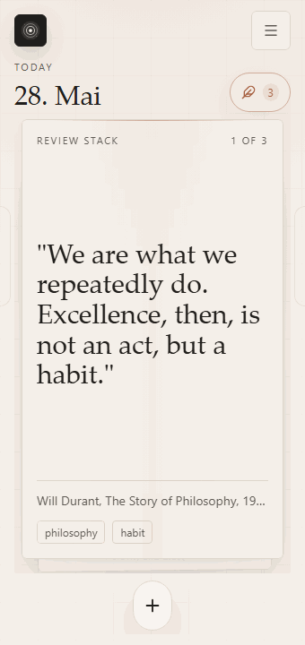
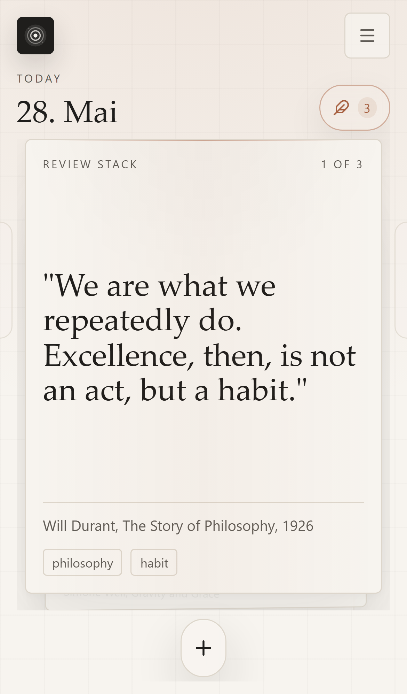
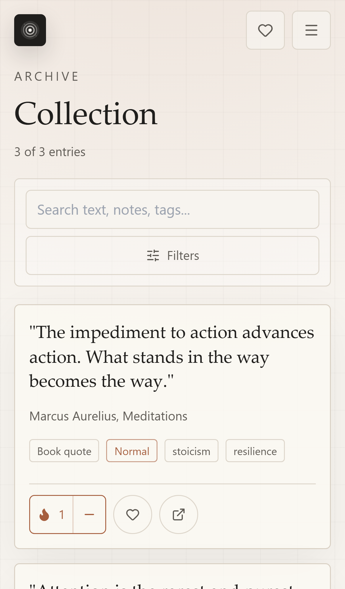
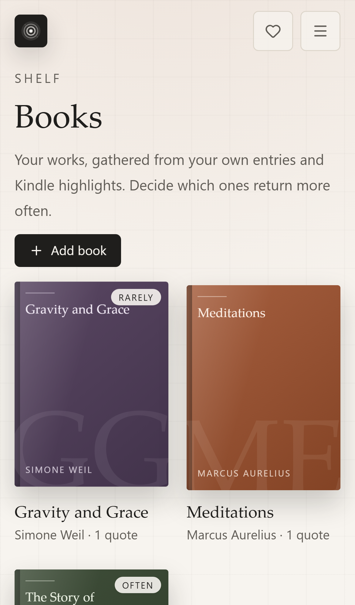

# Quiet Signal

[](https://github.com/ES-92/quiet-signal/actions/workflows/ci.yml)

**A private, swipe-first place to collect quotes and thoughts — and see them again.**
Like Readwise for your own reflections, without the subscription or the cloud.

Quiet Signal is not another notes app. It's for the things you want to *come back to*: a line from a book, a thought on a walk, something someone said. You capture them in seconds, and the app quietly brings them back over the following days and weeks, so they turn into reflection instead of an archive you never open.

Everything stays on your device — no account, no server, no tracking.

> **Live app:** https://quiet-signal.vercel.app · free, installable, works offline
>
> 🇩🇪 *Auf Deutsch?* Die App ist komplett auf Deutsch nutzbar (außerdem Englisch, Spanisch, Französisch).

<p align="center">
  
</p>

<p align="center">
  
  
  
  
</p>

## Why I built it

I wanted a Readwise alternative without a subscription. Obsidian never felt right for this on my phone, and every notes app I tried slowly turned into a pile I stopped looking at. What I actually wanted wasn't more notes, but a calm daily moment to **reflect** on what I had collected — with a UI I can use one-handed, by swiping.

And since it's about reflecting on myself, no provider needs to see any of it. So Quiet Signal is local-first and private by principle: your entries live in your browser, and nothing leaves your device.

I didn't find an app that combines these things, so I built one.

Quiet Signal is built around a simple metaphor: capture the **noise**, keep the **signal**.

## Features

- **Capture anything** — text, photos, and voice notes, in seconds.
- **Triage flow** — new captures land in *Rauschen* (noise); a calm swipe deck lets you keep, snooze, or discard them into *Signal*.
- **Daily review** — a spaced-repetition deck resurfaces your signals over time (weighted by how much they matter to you).
- **Books & sources** — group quotes by book, tune how often a book resurfaces.
- **Reflections** — a quiet weekly/monthly letter built from your own signals.
- **Import & export** — import **Kindle** clippings and **Readwise CSV**; export everything as **JSON, CSV, or Markdown**. Your data is always yours.
- **Private by design** — no account, no cloud, no tracking. Optional **PIN lock** (a view lock) and **AES-GCM vault encryption** for your entries; see the [security model](docs/ARCHITECTURE.md#security-model).
- **Installable PWA** — works offline, "Add to Home Screen", share-target support.
- **Multilingual** — German, English, Spanish, French.

## Who is it for?

Readers who want their Kindle highlights to resurface, people who journal or reflect but don't want a cloud diary, and PKM folks who like the Readwise idea but want it **on their phone, local and private** instead of in someone else's cloud.

Not a Notion/Obsidian replacement — more a small, focused companion for the things you actually want to remember.

## How your data is stored

Everything lives in your browser's **IndexedDB** (via [Dexie](https://dexie.org/)). There is **no backend** — the app is a static PWA. Settings live in `localStorage`. Nothing is sent anywhere. Move your library anytime via JSON/CSV/Markdown export.

## Quickstart

**Just use it:** open https://quiet-signal.vercel.app and (optionally) install it via your browser's "Add to Home Screen".

**Run it locally:**

```bash
git clone https://github.com/ES-92/quiet-signal.git
cd quiet-signal
npm install
npm run dev      # http://127.0.0.1:5173
```

**Build for production:**

```bash
npm run build    # tsc + vite build
npm run preview
```

## Development & tests

```bash
npm install
npm run dev        # dev server
npm test           # unit + component tests (Vitest)
npm run lint && npm run typecheck && npm run build
```

CI runs lint, type check, tests and build on every pull request. Tests are written test-first and use synthetic fixtures only. How the app is put together (layers, data model, review algorithm, security model) is documented in [docs/ARCHITECTURE.md](docs/ARCHITECTURE.md); contribution rules are in [CONTRIBUTING.md](CONTRIBUTING.md).

## Tech stack

React 19 · TypeScript · Vite · TailwindCSS · Zustand · Dexie (IndexedDB) · vite-plugin-pwa. No server, no database to host.

## Roadmap

- Richer reflections and pattern views
- More import sources
- Polished gesture discoverability
- (Your ideas — [open an issue](https://github.com/ES-92/quiet-signal/issues/new/choose)!)

This project intentionally stays **free and local**. There is no paid tier; cloud sync is deliberately out of scope.

## Support

Quiet Signal is free and will stay free. If it helps you build a better reading or reflection habit, you can support its development:

- ☕ [Ko-fi](https://ko-fi.com/esc92)
- 💳 [PayPal](https://paypal.me/ErikSchroeder92)

Donations help with maintenance, documentation, and new import/export integrations. No pressure — using and sharing the app helps just as much.

## Contributing

Issues, ideas, and PRs are welcome — see [CONTRIBUTING.md](CONTRIBUTING.md). Please also read the [Code of Conduct](CODE_OF_CONDUCT.md).

## License

[MIT](LICENSE) © 2026 Erik Schröder
