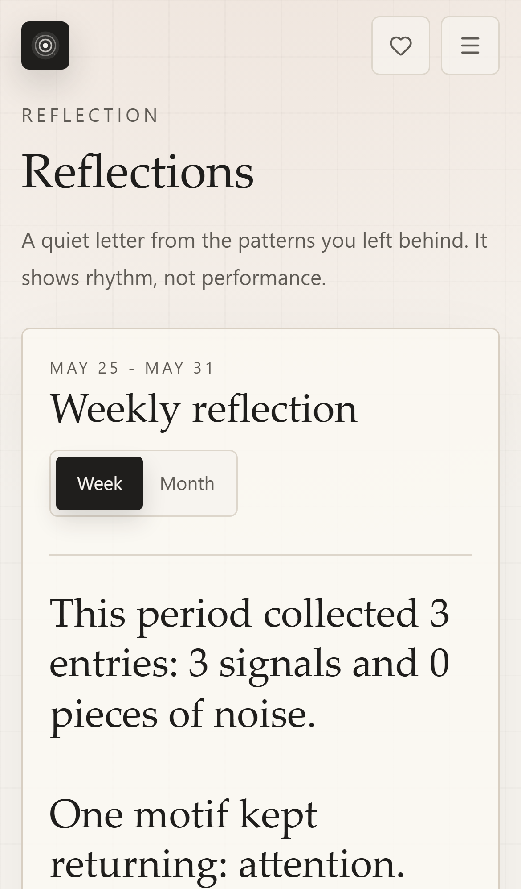

# Quiet Signal

[](https://github.com/ES-92/quiet-signal/actions/workflows/ci.yml)

**A free, local-first, privacy-first commonplace app for notes, quotes, and recurring insights.**

Most highlights and notes disappear into an archive you never open again. Quiet Signal helps you collect thoughts, quotes, photos, and voice notes — and quietly *resurfaces* the ones that matter, so you actually revisit them.

It's a [Readwise](https://readwise.io)-style review flow for your *own* thoughts — without an account, a subscription, a cloud, or any tracking. Everything stays in your browser.

> **Live app:** https://quiet-signal.vercel.app ·

<p align="center">
  
</p>

<p align="center">
  
  
  
  
</p>

## Why?

- You collect quotes, ideas, and highlights — but rarely look at them again.
- You want the "resurface what matters" habit of Readwise, but **local-first and private**.
- You don't want yet another cloud account, subscription, or analytics SDK watching your notes.

Quiet Signal is built around a simple metaphor: capture the **noise**, keep the **signal**.

## Features

- **Capture anything** — text, photos, and voice notes, in seconds.
- **Triage flow** — new captures land in *Rauschen* (noise); in Clarify you keep what touches you as *Signal*, snooze it for later, or discard it.
- **Daily review** — a calm deck shows only the signals that are due. Swipe → to see one more often, ← less often, ↑ to add a dated thought, ↓ to let it rest; "Browse anyway" shuffles through everything without changing any schedule.
- **Books & sources** — group quotes by book, tune how often a book resurfaces.
- **Reflections** — a quiet weekly/monthly letter built from your own signals.
- **Import & export** — import **Kindle** clippings and **Readwise CSV**; export everything as **JSON, CSV, or Markdown**. Your data is always yours.
- **Private by design** — no account, no cloud, no tracking. Optional **PIN lock** (a view lock) and **AES-GCM vault encryption** for your entries; see the [security model](docs/ARCHITECTURE.md#security-model).
- **Installable PWA** — works offline, "Add to Home Screen", share-target support.
- **Multilingual** — German, English, Spanish, French.

## Noise, Signal, Rest

> Collect the noise. Keep what signals. Let the rest go quiet.

- **Noise** (*Rauschen*) — everything that caught your attention before you decided whether it means anything to you. It never returns on its own; it waits to be clarified. Guiding question: *"Did I notice this?"*
- **Signal** — what you consciously kept while clarifying, because it concerns you. Only signals return in the daily stack, as often as you set with → and ←, and you collect dated thoughts on each one. Guiding question: *"Do I want to meet this again?"*
- **Rest** (*Stille*) — a signal that has had its time. It leaves the stack but keeps all its thoughts in your library and can be woken at any time. Guiding question: *"Did this give me what it could?"*

Example: you capture a line by Seneca as noise. While clarifying you keep it as a signal, and it comes back after 1 day. Each time you swipe → it returns a bit later: after 1, 2, 3, 5, 8, 12, 18, 27 … days. If it comes up after 8 days and you swipe ←, the next gap is 32 days. When it has given you what it could, swipe ↓ to let it go quiet: the entry and its thoughts stay in your library, and Wake brings it back, starting again at 1 day.

## Who is it for?

Readers, writers, students, researchers, Obsidian/PKM folks, and anyone who likes the Readwise idea but wants their highlights **local and private** instead of in someone else's cloud.

Not a Notion/Obsidian replacement — more a small, focused companion for the things you actually want to remember.

## How your data is stored

Everything lives in your browser's **IndexedDB** (via [Dexie](https://dexie.org/)). There is **no backend** — the app is a static PWA. Settings live in `localStorage`. Nothing is sent anywhere. Move your library anytime via JSON/CSV/Markdown export.

## Quickstart

**Just use it:** open https://quiet-signal.vercel.app and (optionally) install it via your browser's "Add to Home Screen".

**Run it locally:**

```bash
git clone https://github.com/ES-92/quiet-signal.git
cd quiet-signal
npm install
npm run dev      # http://127.0.0.1:5173
```

**Build for production:**

```bash
npm run build    # tsc + vite build
npm run preview
```

## Development & tests

```bash
npm install
npm run dev        # dev server
npm test           # unit + component tests (Vitest)
npm run lint && npm run typecheck && npm run build
```

CI runs lint, type check, tests and build on every pull request. Tests are written test-first and use synthetic fixtures only. How the app is put together (layers, data model, review algorithm, security model) is documented in [docs/ARCHITECTURE.md](docs/ARCHITECTURE.md); contribution rules are in [CONTRIBUTING.md](CONTRIBUTING.md).

## Tech stack

React 19 · TypeScript · Vite · TailwindCSS · Zustand · Dexie (IndexedDB) · vite-plugin-pwa. No server, no database to host.

## Roadmap

- Richer reflections and pattern views
- More import sources
- Polished gesture discoverability
- (Your ideas — open an issue or a discussion!)

This project intentionally stays **free and local**. There is no paid tier; cloud sync is deliberately out of scope.

## Support

Quiet Signal is free and will stay free. If it helps you build a better reading or reflection habit, you can support its development:

- ☕ [Ko-fi](https://ko-fi.com/esc92)
- 💳 [PayPal](https://paypal.me/ErikSchroeder92)

Donations help with maintenance, documentation, and new import/export integrations. No pressure — using and sharing the app helps just as much.

## Contributing

Issues, ideas, and PRs are welcome — see [CONTRIBUTING.md](CONTRIBUTING.md). Please also read the [Code of Conduct](CODE_OF_CONDUCT.md).

## License

[MIT](LICENSE) © 2026 Erik Schröder
